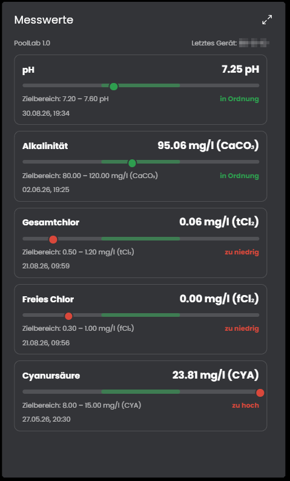
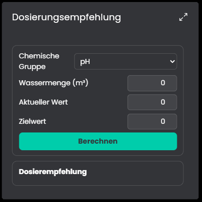
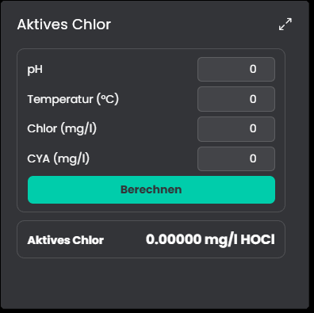

# PoolLab
Dieses Modul überträgt die Messwerte der PoolLab-Photometer aus der LabCOM-Cloud nach IP-Symcon und bietet den Dosierrechner und den Aktivchlor-Rechner der Cloud an. Die Messwerte werden pro Pool aufgebaut, unabhängig davon, welches Gerät misst.

## Inhaltsverzeichnis
- [PoolLab](#poollab)
  - [Inhaltsverzeichnis](#inhaltsverzeichnis)
  - [1. Voraussetzungen](#1-voraussetzungen)
  - [2. Funktionsumfang](#2-funktionsumfang)
  - [3. Enthaltene Module](#3-enthaltene-module)
  - [4. Screenshots](#4-screenshots)
  - [5. Installation](#5-installation)
  - [6. Konfiguration in IP-Symcon](#6-konfiguration-in-ip-symcon)
  - [7. Spenden](#7-spenden)
  - [8. Lizenz](#8-lizenz)

## 1. Voraussetzungen

* IP-Symcon ab Version 9.0
* Ein Konto auf [labcom.cloud](https://labcom.cloud) mit einem API-Token (Benutzereinstellungen)
* Ein Gerät, das seine Messungen in die LabCOM-Cloud überträgt:

Gerät | Übertragung | Stand
------------ | ------------ | ----------------
PoolLab 1.0 | Bluetooth zur App, dann Cloud | getestet
PoolLab 2.0 | Bluetooth oder WLAN direkt zur Cloud | Parameter-IDs aus der Herstellerliste, nicht mit einem Gerät getestet

## 2. Funktionsumfang

* Messwerte aller Pools des Cloud-Kontos als Variablen mit Einheit, Zielbereich, Status und Zeitpunkt
* Gerätewechsel und mehrere Geräte pro Pool laufen in denselben Variablen weiter
* Erkennung von Messbereichsüber- und -unterschreitung
* Kacheln für die Kachel-Visualisierung: Messwerte, Dosierungsempfehlung und Aktives Chlor
* Archivierung der Messwerte, auch nachträglich
* Dosierungsempfehlung und Berechnung des aktiven Chlors über die Cloud

Die einzelnen Funktionen stehen in den Modul-Beschreibungen.

## 3. Enthaltene Module

* [PLCloud](PLCloud/README.md)
  * Gateway zur LabCOM-Cloud mit dem API-Token
* [PLConfigurator](PLConfigurator/README.md)
  * Legt für jeden Pool des Kontos die Instanzen an
* [PLAccount](PLAccount/README.md)
  * Splitter pro Pool, liefert die Poolgröße
* [PLMeasurements](PLMeasurements/README.md)
  * Messwerte eines Pools
* [PLDosageRecommendation](PLDosageRecommendation/README.md)
  * Dosierungsempfehlung
* [PLActiveChlor](PLActiveChlor/README.md)
  * Aktives Chlor

## 4. Screenshots

## 5. Installation
Über den IP-Symcon Module Store.

## 6. Konfiguration in IP-Symcon
1. Auf labcom.cloud unter den Benutzereinstellungen einen API-Token erzeugen.
2. Einen Konfigurator anlegen. Dabei wird das Cloud-Gateway erzeugt, dort den Token eintragen.
3. Im Konfigurator für jeden Pool die gewünschten Instanzen anlegen.

## 7. Spenden

Dieses Modul ist für die nicht kommerzielle Nutzung kostenlos, Schenkungen als Unterstützung für den Autor werden hier akzeptiert:

 

## 8. Lizenz

[CC BY-NC-SA 4.0](https://creativecommons.org/licenses/by-nc-sa/4.0/)
